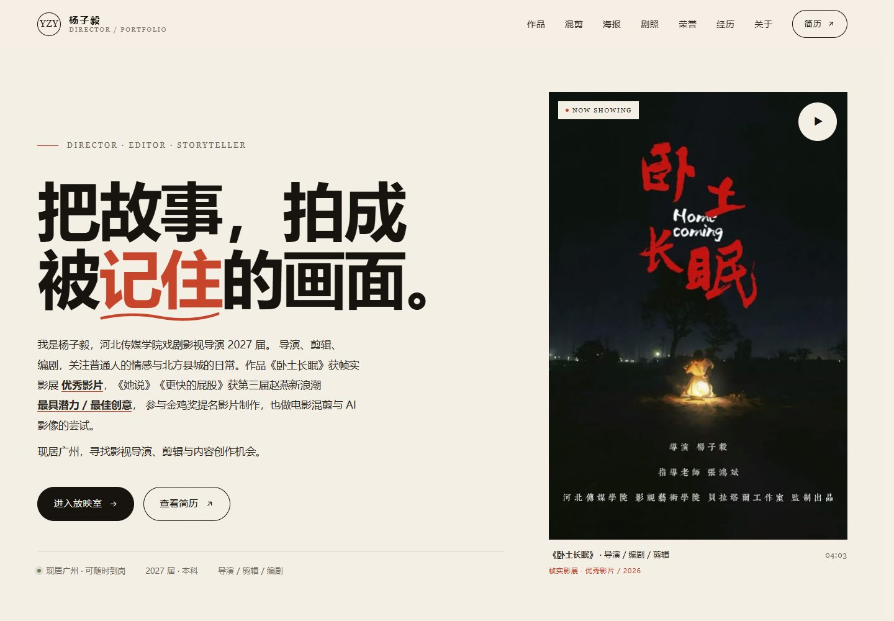
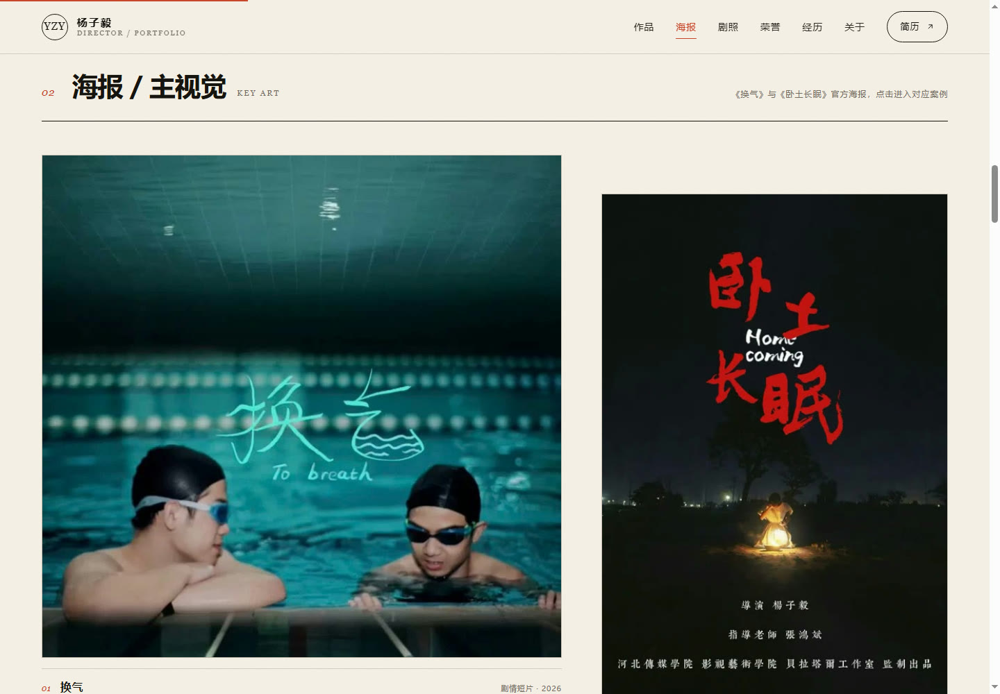
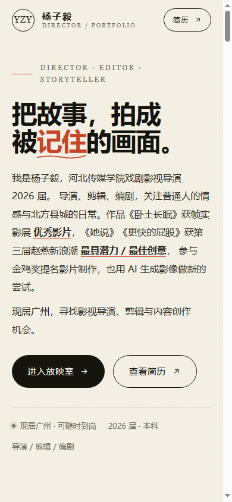
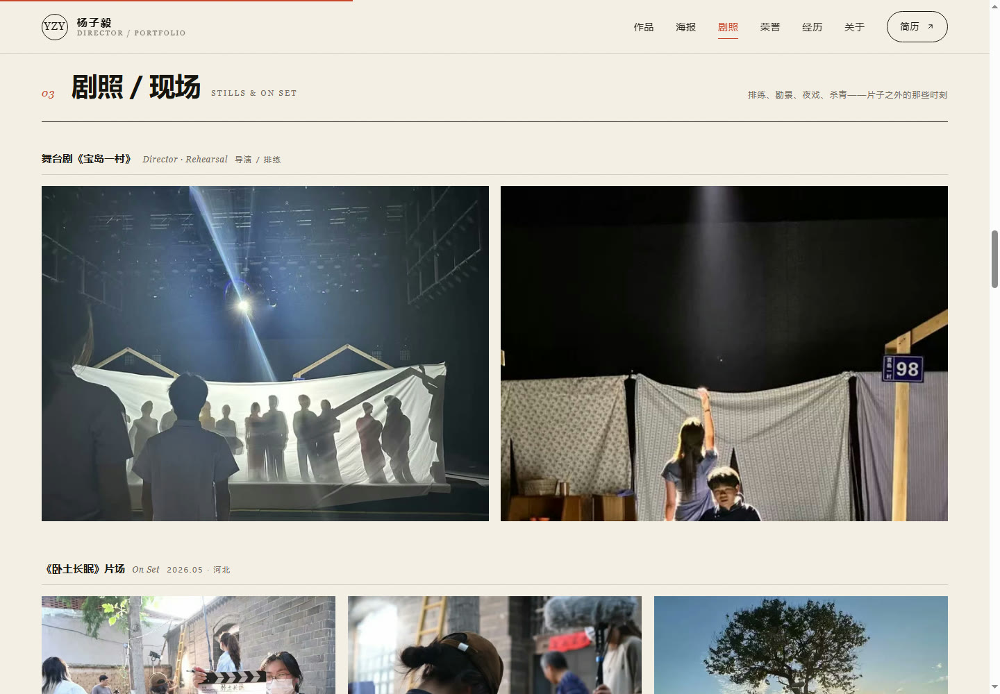
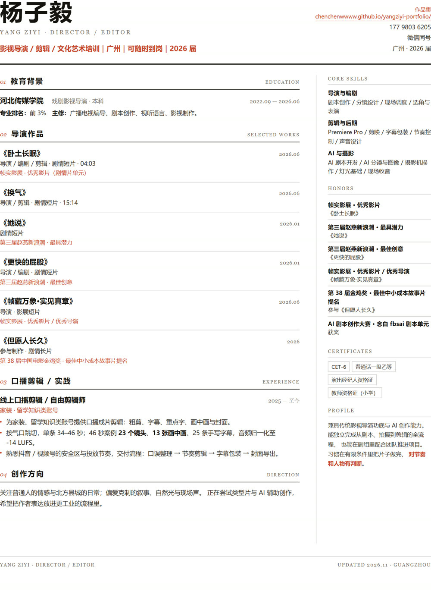

# 杨子毅 · 导演 / 剪辑作品集

一套可以直接上线的个人网站：**作品集主页 + 海报墙 + 剧照墙 + 可在线播放的短片 + 一页 A4 简历**。
无框架、无构建步骤、无外部字体；桌面和手机端都已适配。

## 预览









---

## 这一版改了什么（v3）

1. **新增《换气》**：原来挂在《她说》名下那条 15:14 的视频，确认是《换气》，已独立建条目。页面现在**只展示 01:38 的片段**（`huanqi-clip.mp4`），并在作品列表、弹窗说明和视频注释里都写明了「片段 / 非完整正片」。
2. **《她说》《更快的屁股》改成「证书」条目**：这两支的成片还没上传，条目改为展示获奖证书，不再放视频。
3. **新增 AI 短片**：`10月9日.mp4` 压成 01:25 的网页版，作为「AI 影像实验」条目，用来体现 AI 生成 + 剪辑能力。
4. **新增海报墙**：换气、卧土长眠两张官方海报独立成区，点击进入对应案例。
5. **新增剧照 / 现场区**：《宝岛一村》排练 2 张、《卧土长眠》片场 5 张、影展 1 张，点击可看大图。
6. **新增收尾段**：一段「我还在学」的自述 + 外景照片，收得更温暖。
7. 经历里补了《宝岛一村》舞台剧导演（排练）与 AI 影像实验两段。

---

## 先看这五件事（需要你确认）

1. **AI 短片还没有正式片名**：现在写作「AI 影像实验 / AI Film Study」。定下名字后，改 `index.html` 里 `case-7` 的标题、`#works` 里第 07 行、以及简历里对应的提法即可。
2. **《换气》的署名**：海报上没有演职员，我按「导演 / 剪辑」写。如果你的实际岗位还包括摄影或编剧，改 `index.html` 的 `case-2` 和简历第 02 节。
3. **《宝岛一村》是排练阶段的导演**：文案写的是「导演（排练）／负责围读、舞台调度与灯光配合」。如果实际是正式演出或副导演，改这一条。
4. **《她说》的成片还没有**：条目和证书都在，视频位置留白。拿到成片后放 `assets/video/`，把 `case-3` 的证书封面换成视频即可（可参考 `case-2` 的写法）。
5. **已经上线**：站点在 **https://chenchenwwww.github.io/yangziyi-portfolio/**，简历顶部的作品集链接已经换成这个地址并重导了 PDF。以后换域名，要同步改 `resume.html` 第 22 行再导一次。

另外：手机号与微信会公开展示，投递前想一下是否接受。

---

## 本地预览

**http://127.0.0.1:8080**

如果服务停了，在 `portfolio-site` 目录下运行：

```powershell
node serve.mjs
```

这个脚本支持视频的 Range 请求，拖动进度条不会出问题。

如果 `node` 不在 PATH，可以先用系统 Python：

```powershell
python -m http.server 8080
```

（Python 自带的服务器对视频拖动支持一般，能播但体验不如 `serve.mjs`。）

也可以直接双击 `index.html` 打开（视频同样能播，只是 `resume.html` 里的 localhost 链接需要服务在运行）。

---

## 文件结构

```
portfolio-site/
├─ index.html                 作品集主页：首屏 / 作品 / 海报 / 剧照 / 荣誉 / 经历 / 能力 / 关于 / 收尾 / 联系
├─ resume.html                一页简历，可打印为 PDF
├─ 杨子毅-简历.pdf            已导出的单页 PDF（2026.11 版）
├─ serve.mjs                  本地预览服务（支持视频拖动）
├─ README.md
├─ preview/                   预览图（可删）
└─ assets/
   ├─ css/
   │  ├─ style.css            主页样式；顶部 :root 改配色，底部 v3 区块是海报/剧照/收尾/灯箱
   │  └─ resume.css           简历样式 + A4 打印规则
   ├─ js/
   │  └─ main.js              滚动动效、作品预览、案例弹窗、视频切换、剧照灯箱、时钟
   ├─ img/
   │  ├─ keyart-wotu.jpg      首屏与海报墙：《卧土长眠》竖版海报 480×720
   │  ├─ keyart-huanqi.jpg    海报墙：《换气》海报 720×697
   │  ├─ poster-*.jpg         视频播放器封面（16:9，换气 / 卧土 / AI / 口播）
   │  ├─ still-*.jpg          剧照：宝岛一村 ×2、片场 ×5、影展 ×1
   │  ├─ cert-*.jpg           3 张证书
   │  ├─ award-stage.jpg      帧实影展映后合影
   │  ├─ headshot.jpg         证件照
   │  ├─ work-*.jpg         作品封面（当前页面用 keyart / 证书代替，这两个是备用）
   │  ├─ og-cover.jpg         社交分享图（1200 × 630）
   │  └─ favicon.svg
   └─ video/
      ├─ wotu.mp4            《卧土长眠》04:03，22 MB
      ├─ huanqi-clip.mp4     《换气》展示片段 01:38，12 MB
      ├─ huanqi.mp4          《换气》正片 15:14，29 MB（当前页面未引用）
      ├─ ai-film.mp4         AI 短片 01:25，10 MB
      └─ koubo.mp4           口播剪辑案例 46s，5 MB
```

站点总体积约 80 MB，主要是五段视频。原片仍在 `D:\` 根目录与 `D:\兼职剪辑\`，这里放的是压缩后的网页版本。

---

## 内容在哪里改

### 1. 作品与案例

- `index.html` → `#works`：8 行作品的标题、标签、奖项、`data-preview`
- `index.html` → 8 个 `<dialog class="case">`：每个案例的背景 / 动作 / 结果 / 复盘
- `index.html` → `#posters`：两张海报与说明
- `index.html` → `#stills`：剧照分组、`data-cap`（悬停与灯箱里的说明）
- `index.html` → `#honors`：荣誉清单、证书图片与说明
- `index.html` → `#experience`：口播、短片、舞台剧、AI、金鸡、教育
- `index.html` → `.closing`：收尾那段自述
- `resume.html`：教育、6 部作品、口播经历、技能、荣誉、证书

### 2. 视频

替换 `assets/video/` 里的文件时，保持文件名不变即可：

| 文件 | 对应作品 | 建议 |
| --- | --- | --- |
| `wotu.mp4` | 《卧土长眠》 | 1280×720 / H.264 / AAC / faststart |
| `huanqi-clip.mp4` | 《换气》页面展示片段 01:38 | 1280×720 / H.264 / AAC |
| `huanqi.mp4` | 《换气》正片 15:14（当前页面未引用） | 848×480 / H.264 / AAC / faststart |
| `ai-film.mp4` | AI 影像实验 | 1280×720 / H.264 / AAC |
| `koubo.mp4` | 口播剪辑 | 720×1280 竖屏 / H.264 / AAC |

《换气》现在直接播 `huanqi-clip.mp4`。想恢复「正片 / 片段」切换的话：把 `case-2` 的 `<video>` 换成带 `data-video-box` 的写法，再加回 `vswitch` 那组按钮（`main.js` 里的切换逻辑还在，按钮上写 `data-vsrc` 与 `data-vnote` 即可）。

**部署前如果确定不需要正片**，可以删掉 `assets/video/huanqi.mp4`，站点从约 80 MB 降到约 50 MB。

压缩命令示例（需要本机装 ffmpeg）：

```powershell
ffmpeg -i "D:\11月9日.mp4" `
  -vf "scale=1280:720:force_original_aspect_ratio=increase,crop=1280:720,fps=30" `
  -c:v libx264 -preset medium -crf 26 -maxrate 2400k -bufsize 4800k `
  -c:a aac -b:a 128k -movflags +faststart assets/video/huanqi-clip.mp4
```

### 3. 图片

| 位置 | 建议 |
| --- | --- |
| 首屏 / 海报墙 | 竖版 2:3，`keyart-wotu.jpg`、`keyart-huanqi.jpg` |
| 播放器封面 | 16:9，1280×720；`poster-*.jpg` |
| 剧照 | 任意比例，页面上统一裁成 4:3 方块，点击看原图 |
| 证书 | 保持原图比例；`cert-*.jpg` 已做透视矫正 |
| 人像 | 400×400；`headshot.jpg` |
| 分享图 | 1200×630；`og-cover.jpg` |

换图后记得同步改 `alt` 文字。

### 4. 配色

`assets/css/style.css` 顶部：

```css
--paper: #f5f0e6;
--ink: #171410;
--accent: #c8452a;
--sage: #6f7a5e;
```

`resume.css` 顶部有独立的一套变量，改色时两边保持一致。收尾段是深色区块（`--ink` 底），想换暖色可以改 `.closing` 的背景。

---

## 简历导出 PDF

1. 打开 `resume.html`
2. 点右下角「打印 / 存为 PDF」
3. 选 **A4**、边距 **默认**、勾选「背景图形」、缩放 **100%**
4. 另存为 PDF

当前版本已按 A4 单页调试过（1 页，底部还有余量）。再加作品条目如果溢出，优先把 `.entry__list li` 的字号从 `8.5pt` 调到 `8.2pt`。

命令行重导（和这次用的是同一套）：

```powershell
& "C:\Program Files (x86)\Microsoft\Edge\Application\msedge.exe" `
  --headless=new --disable-gpu --no-pdf-header-footer `
  --print-to-pdf="杨子毅-简历.pdf" "http://127.0.0.1:8080/resume.html"
```

**导出前记得改 `resume.html` 里的作品集链接：**

```html
<a class="portfolio" href="http://localhost:8080">作品集：localhost:8080</a>
```

部署后换成 `https://你的域名/`，再重新打印一版。

---

## 上线

**当前已发布到 GitHub Pages：https://chenchenwwww.github.io/yangziyi-portfolio/**

- 仓库：`chenchenwwww/yangziyi-portfolio`（public）
- 发布源：`main` 分支根目录，站点里放了 `.nojekyll`
- `assets/video/huanqi.mp4`（15:14 正片）被 `.gitignore` 排除，只留在本地，仓库体积 51 MB

改完内容后重新发布（这台机器没有 git，走 GitHub API 推）：

```powershell
cd D:\...\default-workspace
$env:GITHUB_TOKEN="ghp_xxx"      # classic token，勾 repo 权限
node tools\publish-pages.mjs
```

脚本是增量的：只上传内容有变的文件，没变的复用远端 blob。如果你换到一台有 git 的机器，也可以直接 `git clone` 后用普通 git 流程。

下面是备选平台，想换地方时用。

### 方案 A：Netlify Drop（最快）

1. 打开 https://app.netlify.com/drop
2. 把整个 `portfolio-site` 文件夹拖进去
3. 得到 `xxx.netlify.app`，可以继续绑自己的域名

### 方案 B：Vercel

```powershell
npm i -g vercel
cd portfolio-site
vercel
```

Framework Preset 选 **Other**，输出目录留空。

### 方案 C：GitHub Pages

把 `portfolio-site` 里的文件推到仓库根目录，Settings → Pages → Deploy from a branch → `main` / `root`。

上线后（这几步已经做过，换域名或换平台时重做）：

- `resume.html` 里的作品集链接已换成公网地址，PDF 已重导
- `index.html` 的 `og:image` 和 `canonical` 已换成完整地址
- 视频约 51 MB（已排除未引用的 15:14 正片），Pages 能放

---

## 上线前检查

- [ ] 给 AI 短片定一个片名
- [ ] 确认《换气》的署名（导演 / 剪辑）
- [ ] 确认《换气》页面上只放片段、并写明「片段」——如果想让访客看完整正片，再二选一
- [ ] 确认《宝岛一村》是排练还是正式演出
- [ ] 手机上看一遍：作品标题不溢出、视频能播放、证书能横向滑动、剧照点击出大图
- [ ] 点开每个案例，确认视频 / 证书与标题一致
- [x] 简历已换成公网作品集链接并重导 PDF（换域名时要再导一次）
- [x] 部署上线：https://chenchenwwww.github.io/yangziyi-portfolio/
- [ ] 用手机流量（不连 Wi-Fi）打开一次线上地址，确认在国内网络下的速度可以接受

---

## 素材说明

- 原简历：`D:\杨子毅简历.pdf`
- 视频：`D:\10月9日.mp4`（AI 短片）、`D:\11月9日.mp4`（换气片段）、`D:\兼职剪辑\11月6日.mp4`（卧土）、`D:\兼职剪辑\杨子毅分享的视频_成片.mp4`（换气正片）、口播成片
- 海报与剧照来自你提供的图片（换气海报、卧土海报、宝岛一村排练、片场、杀青、影展）
- 案例文字根据简历、证书、视频画面与现场照片整理；如果和你的实际创作过程有出入，直接改文案即可
